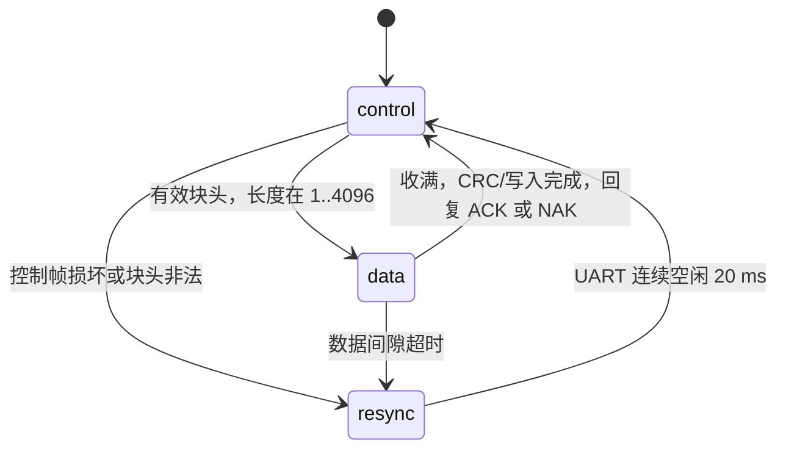

# Bootloader UART 上下文与链路

控制命令、应答和日志使用 tracer 兼容的 HDLC 字节帧。
资产二进制载荷不转义、不分片封装，按有效块头给出的长度原样接收。
新 bootloader 与上传脚本必须配套使用，旧的裸 ACK/NAK 协议不兼容。
AST2 资产目录与每图 CRC 格式保持不变。

## 启动命令握手窗口

无升级标志时，异常日志处理结束后开始 200 ms 接收窗口。USART1
使用 HAL 轮询接收，不使用 UART 中断；仅完整、合法的 F0 HELLO
命令能进入烧写模式，校验包括协议版本、包长度、CRC32、HDLC
校验和及结束 flag。其他命令、噪声、坏帧和半帧不延长窗口。
窗口内没有完成合法握手便继续检查并启动 App。

握手成功后先初始化 NOR 和传输 HSM，再回复 F1 HELLO ACK；
随后可以直接发送块头和原始资产数据，无需第二次 HELLO。
已有升级标志仍可跳过窗口，直接进入烧写模式等待 HELLO。
有效 no-init Fault 的停留分支先于握手窗口，行为不变。

## 分阶段状态机与组件的所有权

Bootloader 顶层 HSM 组织整个启动流程，`main` 只初始化平台、
启动 HSM 并驱动接收事件循环。顶层包含以下阶段：

- `Bl_bootHandshake`：拥有握手期限；接收完整命令事件，在状态处理
  中校验命令并选择目标阶段。当前 HELLO 选择资产传输；后续 IAP/OTA
  命令在这里增加明确的路由，当前未实现这些命令或功能。
- `Bl_bootAssets`：初始化 NOR，持有并驱动资产传输 HSM；串口字节
  和空闲事件交给该组件，顶层不再解释其传输细节。
- `Bl_bootApp`：交接外设、向量表和栈指针，启动 App。
- `Bl_bootFault`：报告后停留，保留后续回滚触发点。
- `Bl_bootInvalidApp`：向量检查不通过时停留。

顶层初始化根据异常留存和升级标志选择初始阶段。握手超时后，
根据 App 向量检查结果进入交接或无效镜像停留阶段。HDLC 解码器
只报告语法完整的命令，阶段选择由顶层 HSM 决定；回调不直接启动
传输或跳转 App。命令派发发生在字节事件处理返回之后。

`bootloader/application/bl_boot.c` 的传输 HSM 持有接收上下文：



- `control`：将字节交给被动的 `HdlcParser` HSM。完整帧的结束 flag
  已消耗后，才产生握手、块头或结束命令事件；在当前字节派发返回后
  再派发命令事件，避免从子解析器回调重入传输 HSM。
- `data`：直接收进 4 KB 块缓冲，任何 flag、escape 或完整控制帧
  形状都只是资产数据。收满后校验、擦写与读回；最后回到 control。
- `resync`：丢弃输入直到线路空闲，防止坏控制头后的资产尾部被
  当作命令。需要回 NAK 时，在线路空闲后回复，再回到 control。

内层 `HdlcParser` 从 sm_tracer_tui 的 C HSM 移植，状态层次不变。
它只解释 flag、转义、sequence、消息 ID、长度、载荷和校验，
不处理 Flash、资产包或传输状态。来源见 `project_common/link/README.md`。
bootloader 链接独立 sm_hsm 内核，端口不依赖 SST 或 FreeRTOS。

## 帧与命令

线上格式：`7E | escaped(seq, id, len8, payload, checksum) | 7E`。
解码后所有字节含 checksum 的和低 8 位为 FF。7E/7D 使用 7D + XOR20
转义，兼容现有 tracer。校验是现有加和校验，不是标准 HDLC CRC16。

| 消息 ID | 内容 |
|---|---|
| F0 | 上位机控制命令：原握手 10 B、块头 7 B、结束命令 9 B |
| F1 | 设备应答：命令字、块号 UINT16 BE、原 ACK/NAK 应答体 |
| F2 | bootloader 文本日志，UTF-8/ASCII |
| 0/1/2 | 固定保留：assertion / 完整异常现场两帧 |
| 113 | no-init 现场无效提示 |

握手和结束命令的应答块号为零。块应答带原块号，避免延迟应答被
用于确认下一块。握手保留原 11 B ACK 体及其 CRC32；块/结束命令
保留单字节状态体，但它们都只存在于完整的 F1 帧内。

每块的线上事务：

```text
PC -> MCU: HDLC(F0, B1 + index16 + length16 + CRC-low16)
PC -> MCU: raw asset bytes[length]  // 完全原样，不经过 HDLC
MCU -> PC: HDLC(F1, B1 + index16 + ACK/NAK)
```

Python 端一次 write 提交控制帧与原始载荷，避免主动制造块内空隙。
C 端只有传输 HSM 的 data 状态消费载荷。坏控制头、缺字节或暂停
导致重同步时，上位机按完整块重传；保留原重复块幂等处理与最终
包 CRC32、每图 CRC 校验。载荷阶段要求发送端连续发送，不支持在
同方向的资产字节中插入控制或日志帧。

反方向的日志与应答可以交替出现，上位机先完整解帧，再按 ID 分流。
日志中的 55/4E 不再被当作 ACK/NAK；烧写模式无需抑制异常输出。
UART 输出仍在 bootloader 主流程中串行进行，没有并发帧写者。

## 验证

```sh
python3 tests/hdlc/run.py
python3 tests/test_asset_loop.py
python3 tests/fault_log/run.py
```

测试包括移植前的解析器用例、C/Python 编解码一致性、任意分段接收、
转义和坏帧恢复、混合日志分流、过期块 ACK、实际上传函数的重试，
以及 Python 发包到实际 C 传输 HSM/写入流程再回到 Python 的闭环。
资产中嵌入有效控制帧，验证 data 状态不解析它；坏控制头后的原始
数据由 resync 丢弃。覆盖数据超时、重新同步与命令/数据状态边界。
2026-10-29 两个镜像已编译并烧录，读回所有 HEX 有效字节一致；
末尾 4 KB 诊断区与烧录前备份相同。升级标志为 0 时，串口 HELLO
收到正确 F1 ACK；RAM 快照确认进入 Bl_bootAssets，协商长度为
464,896 B，写入字节为 0。退出测试后，无命令复位正常进入 App。
串口共解出 43 帧、0 错误；该错误数仅覆盖本次抓包，不保证无丢帧。

正常 App 采样时 tick=11,868、UI 位于 Live、三图有效、NVM 已恢复，
no-init Fault 区为空；用户确认画面、切页和圆弧正常。此次使用软件
复位和短暂停核快照，不是冷上电或无扰观测。
证据：`/tmp/boot-stage-verify-6dsd1cp_/result.json`；Windows 临时目录
同名任务下保留 `uart.bin/json`、`handshake.json` 和 J-Link 日志。

本轮未写资产、未注入新 Fault，未测完整串口烧写吞吐或真实掉电。
完整资产传输和错误边界由宿主测试覆盖。

## 上传脚本入口

Windows 侧运行 `tools/burn-asset.py`，显式传 `--port` 和裸 RGB565
输入。默认通过 J-Link 写升级标志并复位，命令文件生成在 Windows
系统临时目录的独立任务子目录；参数数组传给 J-Link，路径可含空格。
`--noinit` 可以提供从本次 ELF 查得的符号地址，避免 Windows 侧
依赖 arm-none-eabi-nm；地址约定来自 project_layout.h。

`--no-jlink` 跳过探针，可先启动上传脚本，再在 5 s 内人工复位。
脚本每次等待 HELLO 应答最多 50 ms，以覆盖正常启动的 200 ms 窗口。
已有升级标志时仍可不限窗口进入资产阶段；`--handshake-only` 仅握手，
不写资产，也不会自动退出该阶段，需要复位恢复 App。
脚本仍是资产上传工具，不支持 App 固件/IAP/OTA。
